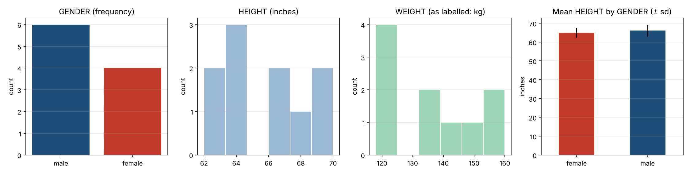

# Height & Weight Descriptives

[](https://www.python.org/)
[](LICENSE)

A small, reproducible example of descriptive analysis for a 12-case height and
weight dataset. The repository includes the original SPSS data and Viewer output,
Python scripts to inspect and summarize the data, a generated chart, and tests
that check key values.

The analysis mirrors the **Frequencies** and **Means** procedures in the
included SPSS output. Python reads the `.sav` data with `pyreadstat`, calculates
the descriptive statistics with pandas and NumPy, and generates a summary
figure with Matplotlib.

## At a glance

| Item | Details |
| --- | --- |
| Cases | 12 |
| Variables | `ID`, `GENDER`, `HEIGHT`, `WEIGHT` |
| Valid height and weight observations | 10 each |
| Missing gender observations | 2 |
| Python requirement | Python 3.10 or later |
| Main analysis | Frequencies, descriptive statistics, and means by gender |

## Visual summary

The chart below is generated by `reproduce_output.py`. It shows the valid gender
counts, the height and weight distributions, and mean height by gender with
standard-deviation error bars.



## Quick start

Clone the repository (replace `<your-username>` with the GitHub account or
organization that hosts it), create a virtual environment, install the
dependencies, and run the tests and analysis:

```bash
git clone https://github.com/<your-username>/spss-height-weight-descriptives.git
cd spss-height-weight-descriptives

# macOS / Linux
python3 -m venv .venv
source .venv/bin/activate

# Windows PowerShell: use these two commands instead of the commands above
# py -m venv .venv
# .venv\Scripts\Activate.ps1

python -m pip install -r requirements.txt
python -m pytest
python reproduce_output.py
```

Running the analysis prints the summary tables to the terminal and saves the
figure to `figures/descriptives.png`. The script reads the checked-in dataset,
so no separate data download is required.

## Analysis details

### Frequencies and descriptive statistics

For `HEIGHT` and `WEIGHT`, the script reports the number of valid and missing
observations, mean, mode, sample standard deviation, skewness, standard error
of skewness, minimum, maximum, and sum. It also reports the valid gender counts
and percentages. Missing observations are excluded from calculations for the
corresponding variable.

The skewness calculation uses pandas' bias-adjusted estimator, which matches
the SPSS skewness value for this dataset. Its standard error is computed using
the SPSS formula.

### Means by gender

For each gender group, the output reports the valid count, mean, and sample
standard deviation for both `HEIGHT` and `WEIGHT`. The figure visualizes the
group means for height and uses standard deviation for the error bars.

## Results

The included dataset has 12 cases. There are 10 valid observations for height
and weight, and 2 missing observations for each of those variables.

**Descriptive statistics**

| Statistic | HEIGHT | WEIGHT |
| --- | ---: | ---: |
| Valid N | 10 | 10 |
| Missing N | 2 | 2 |
| Mean | 65.700 | 136.900 |
| Mode | 64 | 118 |
| Standard deviation | 2.830 | 14.843 |
| Skewness | 0.528 | 0.203 |
| Standard error of skewness | 0.687 | 0.687 |
| Minimum | 62 | 118 |
| Maximum | 70 | 160 |
| Sum | 657 | 1369 |

**Gender frequencies**

| Gender | Frequency | Percent of all cases | Percent of valid cases |
| --- | ---: | ---: | ---: |
| Male | 6 | 50.0% | 60.0% |
| Female | 4 | 33.3% | 40.0% |
| Missing | 2 | 16.7% | — |

**Means by gender**

| Gender | N | Mean HEIGHT (SD) | Mean WEIGHT (SD) |
| --- | ---: | ---: | ---: |
| Male | 6 | 66.17 (3.13) | 135.17 (15.89) |
| Female | 4 | 65.00 (2.58) | 139.50 (15.00) |

Values are descriptive summaries of this small dataset; they are not
inferential tests or evidence of a causal relationship.

## Inspect the SPSS data dictionary

`inspect_sav.py` prints each variable's label, measurement level, value labels,
and missing count, followed by a preview of the data:

```bash
python inspect_sav.py data/dataset_2A.sav
```

For a Markdown-formatted data dictionary (useful in documentation or an issue):

```bash
python inspect_sav.py --markdown data/dataset_2A.sav
```

The script accepts one or more `.sav` files:

```bash
python inspect_sav.py data/dataset_2A.sav path/to/another-file.sav
```

## Data dictionary

The source file `data/dataset_2A.sav` contains 12 cases and 4 variables.

| Variable | Label | Measurement level | Value labels | Missing |
| --- | --- | --- | --- | ---: |
| `ID` | Identification | Nominal | — | 0 |
| `GENDER` | — | Nominal | 0 = male, 1 = female | 2 |
| `HEIGHT` | Measured in Inches | Scale | — | 2 |
| `WEIGHT` | Measured in kgs | Scale | — | 2 |

### Important note about weight units

The SPSS variable label describes `WEIGHT` as **“Measured in kgs”**, but its
values range from 118 to 160. Alongside heights of 62 to 70 inches, those
values look more plausible as pounds than kilograms. The source data and label
are preserved unchanged; verify the intended units before using or interpreting
the weight values.

## Files in this repository

| Path | Description |
| --- | --- |
| [`data/dataset_2A.sav`](data/dataset_2A.sav) | Original SPSS data file (12 cases, 4 variables). |
| [`output/spss_output_A2.spv`](output/spss_output_A2.spv) | Saved SPSS Viewer output, including Frequencies and Means results and SPSS charts. |
| [`reproduce_output.py`](reproduce_output.py) | Reads the dataset, prints the descriptive summaries, and generates the figure. |
| [`inspect_sav.py`](inspect_sav.py) | Displays an SPSS file's data dictionary and a data preview. |
| [`figures/descriptives.png`](figures/descriptives.png) | Summary chart generated by `reproduce_output.py`. |
| [`tests/test_data.py`](tests/test_data.py) | Tests for the data shape, missingness, key summaries, value labels, and Viewer output. |
| [`requirements.txt`](requirements.txt) | Python dependencies for analysis and tests. |
| [`pyproject.toml`](pyproject.toml) | pytest and Ruff configuration. |

The `.spv` file is the saved SPSS Viewer artifact; it is not parsed by the
Python script. The tabulated results above are recomputed from the `.sav` file
and checked by the tests.

## Tests and code style

Run the test suite from the repository root:

```bash
python -m pytest
```

The project also includes Ruff configuration. If Ruff is installed, check the
Python files with:

```bash
ruff check .
```

## License

This project is released under the [MIT License](LICENSE).
